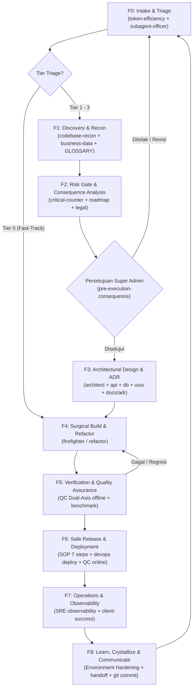

# 🏛️ APEX NEXUS SOVEREIGN (ANS) 2.6 — Master Enterprise SOP & Lifecycle Governance
## Protokol Operasional Siklus Hidup Rekayasa Sistem Universal (26 Core Pillars + 6 Anti-Slop Modules = 32 Skills Symphonic Matrix)

Dokumen ini adalah **Standar Operasional Prosedur Induk (*Master SOP*)** yang mengatur tata kelola rekayasa perangkat lunak, pipeline konten multimedia, mitigasi risiko sistem, alur pembaruan kode, dan rilis produksi di seluruh proyek teknologi yang mengadopsi ekosistem **APEX NEXUS SOVEREIGN (ANS) 2.6**.

Standar ini bersifat **Universal & Agnostik** terhadap jenis sistem — berlaku mutlak untuk pengembangan **Web SaaS, Aplikasi Mobile, Backend API Microservices, Pipeline Data, Produksi Konten Multimedia & Audio/Video Otomatis, Ekosistem AI Agent, CLI Tools, hingga Sistem Transaksional Finansial/Kritis**.

---

## 1. Matriks Triage Berjenjang Universal (*The Universal 4-Tier Triage Matrix*)

Untuk mencegah kelumpuhan analisis (*Analysis Paralysis*) pada perbaikan mikro sembari tetap menjaga keamanan tingkat militer pada komponen kritis, setiap permintaan pengguna wajib diklasifikasikan ke dalam salah satu dari 4 tingkatan:

| Tingkatan (*Tier*) | Kriteria & Contoh Kasus | Alur Prosedur Wajib |
| :---: | :--- | :--- |
| **Tier 0 (Fast-Track Micro-Fixes)** | • Perbaikan typo, pembenahan teks statis label antarmuka UI. • Pembaruan komentar kode, formatting indentasi, atau markdown. • Penambahan log debug lokal non-invasif. • *Tanpa modifikasi logika bisnis, skema basis data, atau otorisasi.* | **Fast-Track:** Backup lokal $\rightarrow$ F0 (Triage) $\rightarrow$ F4 (Edit presisi) $\rightarrow$ F5 (Lint/Test verifikasi kilat) $\rightarrow$ Selesai. *(DIPERBOLEHKAN bypass telaah konsekuensi formal panjang demi efisiensi token).* |
| **Tier 1 (Minor Standard Engineering)** | • Penambahan endpoint REST API baru yang terisolasi. • Penyesuaian styling visual CSS / komponen presentasional baru. • Penambahan unit test baru atau pengayaan cakupan tes. • Perbaikan bug minor terisolasi pada satu fungsi modular. | **Standard Track:** Backup lokal $\rightarrow$ F0 $\rightarrow$ F2 (Telaah Konsekuensi Ringkas) $\rightarrow$ **Persetujuan Super Admin** $\rightarrow$ F4 $\rightarrow$ F5 (QC Offline 100% pass) $\rightarrow$ Laporan. |
| **Tier 2 (Major Core & Business Logic)** | • Modifikasi algoritma inti, alur transaksi, atau formula kalkulasi bisnis. • Migrasi / perubahan skema persistensi basis data (SQL/NoSQL) atau state JSON. • Refaktorisasi multi-file lintas komponen sistem. • Integrasi API eksternal kritis atau layanan pihak ketiga berbayar. • Deployment ke server produksi live (VPS / Cloud / Container). | **Enterprise Safe Track (SOP 7 Langkah Penuh):** F0 $\rightarrow$ F1 $\rightarrow$ F2 (Telaah Konsekuensi Lengkap) $\rightarrow$ **Persetujuan Super Admin** $\rightarrow$ F3 (Pembaruan ADR jika ada) $\rightarrow$ F4 $\rightarrow$ F5 (QC Offline Dual-Axis) $\rightarrow$ F6 (Backup Server Zip $\rightarrow$ Deploy $\rightarrow$ QC Online Live) $\rightarrow$ F7 $\rightarrow$ F8. |
| **Tier 3 (Critical Infrastructure, Security & Live Assets)** | • Modifikasi kredensial produksi, secret keys, atau token otentikasi. • Perubahan arsitektur keamanan, IAM, otorisasi multi-tenant, atau enkripsi. • Modifikasi konfigurasi root server, firewall (UFW), Reverse Proxy (Nginx), atau TLS/SSL. • Migrasi basis data produksi skala besar atau pemotongan alur moneter/keuangan. | **Comprehensive Governance Track:** Seluruh fase F0 s.d. F8 + Audit Roadmap Teknis (`engineering-roadmap-risk-strategist`) + Audit Keamanan STRIDE (`cybersecurity-threat-modeler`) + Audit Kepatuhan Regulasi (`legal-compliance-regulatory-guardian`) + Konfirmasi tertulis di setiap gerbang. |

---

## 2. Sembilan Fase Siklus Hidup Rekayasa (*The 9 Lifecycle Phases F0–F8*)

### Rincian Tanggung Jawab Tiap Fase:

1. **Fase F0 (Intake, Triage & Sovereign Grill-Me Onboarding):**
   - *Pilar:* `token-context-efficiency-architect`, `subagent-operations-officer`, & `pre-execution-consequence-analysis`.
   - *Tindakan:*
     - Jika proyek baru diinstal (`DESIGN.md` / `GLOSSARY.md` masih berupa template kosong) atau pengguna baru memulai sesi tanpa instruksi spesifik, tampilkan **Sambutan Pemandu Aktif (*Proactive Vision Trigger*)**: *"Apa yang ingin kamu lakukan sekarang? Ceritakan visimu!"* beserta menu jalur cepat yang ramah orang awam.
     - Jalankan **Sovereign Grill-Me Interview**: wawancarai pengguna dengan 2–3 pertanyaan pilihan ganda yang memiliki opsi `(Rekomendasi)` untuk mengunci kebutuhan bisnis (`GLOSSARY.md`) dan ciri khas visual (`DESIGN.md`).
     - Klasifikasikan tugas ke dalam Tier (0–3) dan muat hanya skill yang relevan (*Selective Skill Loading*) demi efisiensi token.
2. **Fase F1 (Discovery & Reconnaissance):**
   - *Pilar:* `codebase-recon-archaeologist` & `business-data-intelligence-analyst`.
   - *Tindakan:* Membaca kamus domain `GLOSSARY.md` untuk mencegah ambiguitas istilah, memetakan dependensi (*Chesterton's Fence*), dan membaca histori arsitektur.
3. **Fase F2 (Risk Gate & Consequence Analysis):**
   - *Pilar:* `critical-counter-analyst`, `engineering-roadmap-risk-strategist`, `legal-compliance-regulatory-guardian`, dan `pre-execution-consequence-analysis`.
   - *Tindakan:* Menyajikan Lembar Telaah Konsekuensi (Tujuan, Upside, Downside teknis/operasional riil, dan Rekomendasi Mitigasi). **Menunggu persetujuan eksplisit Super Admin.**
4. **Fase F3 (System Design & ADR Documentation):**
   - *Pilar:* `enterprise-systems-architect`, `api-design-integration-specialist`, `database-architect-data-guardian`, `uiux-research-applicator`, `multimedia-content-pipeline-architect`, `cybersecurity-threat-modeler`.
   - *Tindakan:* Merancang antarmuka kontrak, idempotency locks, pemodelan data atomik, komposisi tipografi/multimedia, dan mencatat keputusan arsitektural ke `docs/adr/XXXX-[nama].md`.
5. **Fase F4 (Build & Surgical Refactoring):**
   - *Pilar:* `code-fixer-firefighter`, `code-refactor-optimizer`, `workflow-automation-orchestrator`, `multimedia-content-pipeline-architect`, dan 6 modul `antislop*`.
   - *Tindakan:* **Kunci Gerbang 0 (Tight Feedback Loop First):** membuat umpan balik kegagalan deterministik (<3 detik) sebelum menyentuh kode. Penulisan kode/aset bersih, modular, bebas *band-aid patch*, dan lulus filter `antislop`.
6. **Fase F5 (Verification & Dual-Axis Quality Assurance):**
   - *Pilar:* `quality-control-auditor` (Audit Independen Offline), `data-intelligence-benchmark-evaluator`, `cybersecurity-threat-modeler`.
   - *Tindakan:* Dual-Gate Verification:
     1. **Gerbang Fungsional & Visual (Sumbu 1):** 100% unit tests lolos (0 fail, 0 regresi), verifikasi fungsionalitas, inspeksi visual UI (`contrast-check.py`), dan verifikasi kontras/tabrakan cahaya thumbnail (`scripts/verify_visual_contrast.py`) jika relevan.
     2. **Gerbang Kualitas Deterministik Anti-Slop (Sumbu 2):** Eksekusi `aislop scan` wajib mencapai **Skor $\ge 80/100$** dan **0 Critical Errors** (bebas dari *swallowed exceptions*, *hallucinated imports*, *dead code*, dan *duplicate helper blocks*).
7. **Fase F6 (Safe Release & Deployment):**
   - *Pilar:* `enterprise-development-sop`, `devops-infrastructure-deployer`, `quality-control-auditor` (Audit Online Live).
   - *Tindakan:* Menjalankan Alur 7 Langkah SOP Rilis Standar Enterprise.
8. **Fase F7 (Operations & Observability):**
   - *Pilar:* `sre-observability-incident-commander`, `client-success-aftersales-specialist`.
   - *Tindakan:* Pemantauan telemetri runtime live (CPU, RAM, Event Loop Latency), deteksi kegagalan hening (*silent failure detection*), dan mitigasi degradasi layanan.
9. **Fase F8 (Learn, Crystallize & Communicate):**
   - *Pilar:* `client-documentation-manual-writer`, `digital-marketing-growth-strategist`, dan `Sovereign Adaptive Evolution Engine (SAEE)`.
   - *Tindakan:* **Environment Hardening Retrofit:** Mengubah pelajaran insiden menjadi proteksi otomatis mesin (*pre-commit hook* menguji test & slop, *linter*, *compiler flags*), memperbarui status serah-terima di `.agents/handoff.md`, dan meminta konfirmasi Git commit secara eksplisit.

---

## 3. Alur Kerja Wajib Pembaruan Kode & Rilis Produksi (SOP 7 Langkah)

Setiap pembaruan sistem yang melibatkan rilis ke lingkungan produksi/server wajib mengikuti 7 langkah berikut tanpa terlewat:

1. **Langkah 1: Backup Lokal Offline:** Sebelum menyentuh kode, lakukan pencadangan (*backup*) file asli yang akan diubah ke direktori `backups/backup_local_pre_[feature]_[timestamp]`.
2. **Langkah 2: Eksekusi Offline:** Terapkan pembaruan kode pada lingkungan lokal secara presisi dan terisolasi.
3. **Langkah 3: QC Offline (Sub-agen Independen):** Panggil sub-agen `quality_control` untuk memvalidasi kepatuhan spesifikasi, menjalankan suite unit test (100% pass), dan mengecek kebersihan arsitektur deterministik via `aislop scan` (Skor $\ge 80/100$, 0 critical errors).
4. **Langkah 4: Backup Server Produksi (Download Zip):** Unduh arsip snapshot file produksi dari server sebelum ditiban dan simpan di komputer lokal dalam format `.zip` dengan nama `backup_YYYYMMDD_HHMMSS.zip` (Jaring Pengaman Rollback Wajib).
5. **Langkah 5: Deploy ke Server Produksi:** Unggah file yang telah tervalidasi ke server, terapkan konfigurasi, dan jalankan restart layanan yang diperlukan (misal `pm2 restart`, container restart, dsb).
6. **Langkah 6: QC Online Live (Sub-agen Independen):** Jalankan sub-agen `quality_control` sekali lagi secara online pada server live untuk memverifikasi proses runtime sehat (*zero crash loop*), endpoint merespons HTTP valid, dan integritas berkas terkonfirmasi.
7. **Langkah 7: Laporan Final & Konfirmasi Git Commit:** Laporkan hasil akhir secara formal kepada Super Admin, lalu tanyakan secara eksplisit: *"Apakah progress terbaru ini mau dicommit ke Git sekarang?"*.

---

## 4. Enam Pilar Inovasi Universal ANS (Matt Pocock Synthesis)

1. **Pilar 1 — Domain Modeling Engine (`GLOSSARY.md`):**  
   Setiap proyek ANS wajib memiliki kamus domain di root repositori yang merinci bahasa universal (*ubiquitous language*), invarian domain yang tidak boleh dilanggar, serta istilah terlarang (*forbidden ambiguities*) untuk mengeliminasi salah paham istilah AI (*semantic drift*).
2. **Pilar 2 — Modular Architecture Decision Records (`docs/adr/`):**  
   Setiap keputusan arsitektural penting dicatat dalam file terpisah (`0001-xxx.md`, `0002-xxx.md`) berisi Status, Konteks, Keputusan, Konsekuensi, dan Pagar Pengaman Kepatuhan, mencegah pembengkakan file catatan monolitik.
3. **Pilar 3 — Portable Session Handoff (`.agents/handoff.md`):**  
   Menyediakan protokol serah-terima status kerja yang persisten saat sesi ditutup atau jendela konteks penuh, merangkum identitas sesi, pekerjaan yang sedang berjalan, dan satu instruksi deterministik berikutnya.
4. **Pilar 4 — Dual-Axis Code Review Matrix (`quality-control-auditor`):**  
   Audit kualitas kode membedah dua sumbu ortogonal:
   - *Axis 1: Specification Fidelity* (Kepatuhan mandat 100%, zero scope creep, penanganan boundary conditions, unit tests pass 100%).
   - *Axis 2: Clean Design & Deterministic Anti-Slop (`aislop`)* (Evaluasi deterministik sub-detik dengan target Skor $\ge 80/100$, bebas dari *Primitive Obsession*, *Feature Envy*, *God Object*, *swallowed exceptions*, mutasi liar, dan duplikasi helper).
5. **Pilar 5 — Tight Feedback Loop First (`code-fixer-firefighter`):**  
   Sebelum mengubah baris kode apa pun saat memadamkan bug, agen **WAJIB** membuat pengujian deterministik (<3 detik) yang mereproduksi anomali tersebut (Fase Red). Dilarang keras melakukan perbaikan berbasis tebakan spekulatif.
6. **Pilar 6 — Environment Hardening Retrofit (SAEE):**  
   Setiap kegagalan atau pelajaran yang didapat tidak boleh hanya diserahkan pada ingatan manusia atau komentar teks, melainkan **wajib diubah menjadi aturan deterministik mesin** (*pre-commit hook* menguji unit test & `aislop scan`, aturan *ESLint*, flag *strict compiler*, unit test regresi permanen).

---

## 5. Pagar Pengaman Kedaulatan Super Admin

1. **Kedaulatan Persetujuan Kode (Tier 1–3):** AI **DILARANG KERAS** menyentuh atau memodifikasi kode logika bisnis, skema data, konfigurasi infrastruktur, atau endpoint produksi sebelum mendapatkan persetujuan dari Super Admin.
2. **Kedaulatan Kontrol Versi (Git Commit):** AI **DILARANG KERAS** melakukan `git commit` secara otomatis atau diam-diam. Eksekusi `git commit` HANYA boleh dijalankan setelah Super Admin memberikan jawaban persetujuan eksplisit.
3. **Jaring Pengaman Rollback Wajib Ada:** Tidak ada deployment server yang sah tanpa file cadangan fisik `backup_YYYYMMDD_HHMMSS.zip` yang tersimpan aman di komputer lokal.
