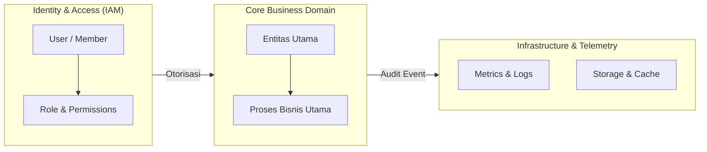

# 📖 [PROJECT NAME] — Formal Domain Model & Ubiquitous Language
## APEX NEXUS SOVEREIGN (ANS) Universal Domain Knowledge Standard

> **Tujuan Dokumen:**  
> Dokumen ini adalah **Kamus Domain Resmi (*Single Source of Semantic Truth*)** bagi seluruh agen AI, developer, dan pemangku kepentingan. Dokumen ini mendefinisikan terminologi, batas entitas (*bounded contexts*), aturan invariant yang tidak boleh dilanggar, serta melarang ambiguitas kata (*semantic drift*) demi menjaga keselarasan pemahaman sistem 100%.

---

## 1. Bahasa Universal (*Ubiquitous Language & Core Entities*)

Definisikan setiap istilah kunci yang digunakan dalam basis kode, antarmuka pengguna, dan basis data:

| Istilah / Entitas | Definisi Presisi | Padanan di Kode / Database | Contoh Nilai Valid |
| :--- | :--- | :--- | :--- |
| **`[Entity_A]`** | [Deskripsi entitas, kepemilikan, dan fungsinya dalam sistem] | `src/models/entity_a.ts` / table `entities_a` | `{ id: "uuid", status: "ACTIVE" }` |
| **`[Entity_B]`** | [Deskripsi entitas] | `src/models/entity_b.ts` | ... |
| **`[Tenant]`** | Unit organisasi penyewa layanan yang mengisolasi data, konfigurasi, dan akses pengguna secara mandiri. | `serverId` / `organizationId` / `tenantId` | `org_prod_01` |
| **`[Session]`** | Status otentikasi aktif yang mewakili pengguna terverifikasi dalam rentang waktu aman. | `sessionToken` / `jwtClaims` | Token JWT bertanda tangan HMAC |

---

## 2. Peta Batas Domain (*Bounded Contexts & Subdomains*)

1. **Identity & Access Management (IAM):** Mengatur otentikasi, otorisasi, hak akses berbasis peran (RBAC/ABAC), dan sesi.
2. **Core Domain:** Logika bisnis spesifik proyek (transaksi, pipeline data, manajemen konten, orkestrasi bot, dsb).
3. **Billing & Subscriptions (Jika ada):** Penanganan invoice, lisensi, kuota penggunaan, dan integrasi payment gateway.
4. **Operations & Observability:** Structured logging, alarm kegagalan, telemetri performa, dan jaring pengaman kesehatan sistem.

---

## 3. Invarian Domain yang Tidak Boleh Dilanggar (*Domain Invariants*)

Invarian adalah kebenaran logika absolut (*absolute logical truths*) yang **WAJIB SELALU TERPENUHI** dalam kondisi apa pun:

1. **Invarian 1 (Data Isolation):** Data milik Tenant A **TIDAK PERNAH BOLEH** dapat diakses atau diubah oleh Tenant B dalam query apa pun (Multi-Tenant Zero Leaks).
2. **Invarian 2 (State Transition Validity):** Transisi status entitas wajib melalui mesin status (*Finite State Machine*) yang terverifikasi (misal: status `CANCELLED` tidak boleh langsung meloncat ke `COMPLETED`).
3. **Invarian 3 (Numeric Integrity):** Nilai numerik sensitif (kuota, saldo, nominal, waktu latensi) dilarang bernilai `NaN`, `null`, atau string tidak terformat. Gunakan pembulatan terkontrol dan tipe data presisi.
4. **Invarian 4 (Idempotency):** Setiap mutasi data kritis melalui API/Webhook yang menyertakan kunci unik (`Idempotency-Key` atau `eventId`) wajib menghasilkan output yang sama jika dieksekusi berulang kali tanpa duplikasi efek samping.

---

## 4. Istilah Terlarang & Pencegah Ambiguitas (*Forbidden Ambiguities*)

Untuk mencegah agen AI mengalami salah persepsi (*hallucination / semantic drift*), istilah-istilah ambigu berikut **DILARANG DIGUNAKAN** dan wajib diganti dengan padanan resminya:

| ❌ Kata Ambigu / Dilarang | Alasan Pelarangan | ✅ Istilah Resmi yang Wajib Digunakan |
| :--- | :--- | :--- |
| *"User"* (tanpa konteks) | Menimbulkan kebingungan antara Super Admin, Klien SaaS, atau Pengguna Akhir. | Gunakan spesifik: `SuperAdmin`, `TenantOwner`, atau `EndUser`. |
| *"Account"* | Ambigu antara kredensial login, akun perbankan, atau profil organisasi. | Gunakan: `AuthProfile`, `BankAccount`, atau `TenantAccount`. |
| *"Order"* | Ambigu antara pesanan pembelian, urutan sorting array, atau instruksi sistem. | Gunakan: `PurchaseOrder`, `SortOrder`, atau `SystemCommand`. |
| *"Delete"* (tanpa spesifikasi) | Berisiko menghapus data permanen (*hard delete*) padahal sistem menerapkan retensi data. | Gunakan: `SoftDelete` (menandai flag `isDeleted: true`) atau `HardPurge`. |

---

## 5. Konvensi Penamaan (*Naming Conventions*)

- **Berkas Kode & Komponen:** `PascalCase` untuk Komponen/Kelas UI, `kebab-case` atau `snake_case` untuk modul utilitas/layanan.
- **Tabel / Koleksi Database:** `snake_case` jamak (contoh: `users`, `audit_logs`, `tenant_configs`).
- **Endpoint REST API:** Huruf kecil jamak dengan pemisah strip (contoh: `/api/v1/tenant-members/:id`).
- **Variabel Lingkungan (.env):** `SCREAMING_SNAKE_CASE` (contoh: `DATABASE_URL`, `JWT_SECRET`).
