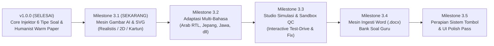

# 🗺️ Master Roadmap Pengembangan Afresto AI Assistant (Versi 2.0)
## Konsolidasi Rencana Pengembangan Berkelanjutan — Standar APEX NEXUS SOVEREIGN (ANS)

Dokumen ini adalah **peta jalan resmi (*master roadmap*)** yang menyatukan seluruh rencana pengembangan yang telah disepakati bersama Super Admin. Urutan pelaksanaan telah disesuaikan di mana **Mesin Gambar AI & Diagram Vektor** diprioritaskan pertama, diikuti oleh **Multi-Bahasa**, **Studio Simulasi QC Guru**, lalu **Ingesti Bank Soal Word (.docx)**, dan ditutup dengan **Perapian Tombol & UI Polish**.

---

### 📌 Ringkasan Urutan Eksekusi Milestone (Reordered):

---

### 🎨 1. MILESTONE 3.1: Mesin Ilustrasi Gambar AI & Diagram Vektor Multimodal (SEKARANG)
> *Tujuan:* Menghadirkan ilustrasi visual nyata, akurat, bebas biaya (Rp 0 tanpa kartu kredit), dan tidak abstrak langsung ke dalam formulir soal Afresto.

* **Dokumen ADR:** [`docs/adr/0004-multimodal-interactive-qc-studio-and-multilingual-architecture.md`](file:///d:/Google%20Antigravity/Add%20On%20Afresto/docs/adr/0004-multimodal-interactive-qc-studio-and-multilingual-architecture.md)
* **Spesifikasi Teknis:**
  1. **100% Gratis Tanpa Kartu Kredit:**
     - Menggunakan **Pollinations AI (FLUX / SDXL)** di latar belakang untuk foto/kartun tanpa perlu API key tambahan dan tanpa biaya.
     - Gambar diunduh dan dikonversi otomatis menjadi **Base64 Inline Data (`data:image/jpeg;base64,...`)** berukuran teroptimasi ($\pm$ 25–40 KB) agar tersimpan permanen di database Afresto tanpa risiko *broken link*.
  2. **Pencegah Gambar Abstrak (*Concrete Anchoring*):**
     - Gemini bertindak sebagai penerjemah visual: Mengubah konsep abstrak (misal: *"konsep bisnis TJKT"*) menjadi objek fisik konkret 3D (misal: *"siswa berseragam lab memegang kabel LAN kuning yang dicolokkan ke router Cisco di meja kayu"*).
  3. **Dukungan Ragam Gaya Visual:**
     - 📸 **Foto Realistis:** Untuk studi kasus situasi, industri, profesi, alat kerja nyata.
     - 🧸 **Kartun 3D / Animasi:** Karakter ramah siswa bergaya animasi 3D.
     - 📐 **Ilustrasi 2D Flat / Vektor:** Gaya ilustrasi buku cetak Kurikulum Merdeka.
  4. **Diagram Presisi Matematis (SVG Vektor):**
     - Untuk Matematika, Fisika, dan Topologi TJKT, Gemini membuat kode SVG asli berbasis koordinat presisi (garis sudut siku-siku, kurva parabola, skema rangkaian listrik).
  5. **Integrasi UI & Injektor:**
     - Kotak centang opsional di form: `[✓] Sertakan Ilustrasi Gambar AI`.
     - Tampilan thumbnail preview gambar di setiap kartu playlist sidepanel lengkap dengan tombol `[🎨 Buat Ulang]` dan `[📁 Ganti File Sendiri]`.
     - Injektor menyematkan tag `` tepat di atas narasi soal pada editor TinyMCE Afresto (`pertanyaan_ifr`).

---

### 🌍 2. MILESTONE 3.2: Adaptasi Kurikulum Multi-Bahasa Asing & Daerah
> *Tujuan:* Memberikan dukungan penuh bagi guru mata pelajaran bahasa asing dan bahasa daerah tanpa kendala karakter rusak.

* **Spesifikasi Teknis:**
  1. **Bahasa Arab:**
     - Teks berharakat lengkap (*Fathah, Kasrah, Dhommah, Sukun, Tanwin*).
     - Deteksi otomatis arah baca kanan-ke-kiri (**Right-to-Left / RTL**) pada editor TinyMCE Afresto (`dir="rtl"`).
  2. **Bahasa Jepang:**
     - Dukungan karakter Kanji, Hiragana, Katakana, dan Romaji berstandar JLPT N5–N4.
  3. **Bahasa Jawa:**
     - Kosakata tingkatan *Ngoko, Krama Lugu, Krama Alus (Inggil)*, tembang macapat, dan peribahasa Jawa baku.
  4. **Bahasa Perancis & Jerman:**
     - Karakter diakritik Eropa (*é, è, ê, ç, à, ä, ö, ü, ß*) terjamin utuh dengan standar encoding UTF-8 anti-korup.

---

### 🎮 3. MILESTONE 3.3: Studio Simulasi & Sandbox QC Guru (Interactive Test-Drive) — [SELESAI & TERVERIFIKASI QC GRADE A+]
> *Tujuan:* Menjamin 100% soal bebas cacat (*Zero Defect*) dengan memberi ruang bagi guru untuk mencoba mengerjakan soalnya layaknya siswa di layar penuh sebelum disuntikkan ke Afresto.

* **Spesifikasi Teknis:**
  1. **Full-Tab Dedicated Studio (`preview/preview.html`):**
     - Membuka tab layar penuh yang lega (100% layar laptop guru), bebas dari kesempitan sidepanel 380px.
     - Format naskah ujian sekolah bersih dengan KOP Soal, stimulus besar, gambar tajam, dan rumus matematika lega.
  2. **Mode Simulasi Pengerjaan Siswa (*Test-Drive Mode*):**
     - Opsi jawaban interaktif bisa diklik guru (radio button PG, checkbox multi-kunci, tabel Benar/Salah, dropdown jodoh, input teks isian, textarea uraian).
     - Tombol **`[ Periksa Jawaban ]`** membandingkan jawaban guru dengan kunci AI:
       - 🟢 *Cocok:* Kunci jawaban terverifikasi tepat.
       - ⚠️ *Meleset:* Peringatan jika ada potensi kunci AI salah atau opsi ambigu.
  3. **Alat Penyelamat Cacat Sekali-Klik (*1-Click Safeguards*):**
     - **`[ 📌 Jadikan Jawaban Saya Sebagai Kunci ]`:** Mengoreksi kunci jawaban yang keliru dengan 1 klik tanpa edit rumit.
     - **`[ 🔄 Buat Ulang Butir Ini Saja (Single Targeted Regenerate) ]`:** Jika soal nomor 3 rusak, AI hanya merancang ulang butir nomor 3 tanpa menyentuh butir nomor lain.
     - **`[ ✏️ Edit Teks Langsung ]`:** Penyuntingan teks, opsi, atau pembahasan langsung di layar secara inline.
  4. **Fungsi Cetak / Export PDF:**
     - Tombol **`[ 🖨️ Cetak / Simpan PDF ]`** berformat naskah cetak fisik resmi sekolah untuk arsip kurikulum atau ujian tertulis (`@media print` anti-potong halaman).
     - Dilengkapi lembar terpisah lampiran kunci jawaban dan pedoman penskoran guru.
  5. **Tombol Eksekusi Instan:**
     - **`[ 🚀 Suntikkan Paket Terverifikasi ke Afresto ]`** untuk langsung beralih ke formulir Afresto.
  6. **Sinkronisasi Otomatis Dua Arah:**
     - Modifikasi di Studio Preview otomatis tersinkronisasi kembali ke Playlist Sidepanel via `chrome.storage.onChanged`.

---

### 📦 4. MILESTONE 3.4: Mesin Ingesti Bank Soal Word (.docx) Guru — [SELESAI & TERVERIFIKASI QC GRADE A+]
> *Tujuan:* Membantu guru yang sudah memiliki bank soal naskah Word (.docx) agar tidak perlu mengetik ulang atau prompt satu-satu.

* **Dokumen ADR:** [`docs/adr/0003-word-docx-document-ingestion-engine.md`](file:///d:/Google%20Antigravity/Add%20On%20Afresto/docs/adr/0003-word-docx-document-ingestion-engine.md)
* **Spesifikasi Teknis:**
  1. **Client-Side Parser (`scripts/docx_parser.js`):**
     - Membaca Central Directory ZIP dan mendekompresi entri dokumen menggunakan native `DecompressionStream` (Zero-Server, Zero-Dependency, privasi dokumen ujian 100% aman).
     - Menjaga integritas tabel dengan formatting markdown pipe delimiter dan mengekstrak gambar media `word/media/` ke Base64 Data URL.
  2. **AI Document Structurer (`scripts/gemini.js`):**
     - Metode `structureDocxQuestions` menata teks dokumen heterogen ke 6 tipe soal standar ekstensi (`PG`, `PG_KOMPLEKS`, `BENAR_SALAH`, `MENCOCOKKAN`, `ISIAN`, `URAIAN`).
     - Deteksi kunci jawaban heterogen (di samping nomor, di bawah butir, tabel kunci akhir dokumen, atau tanda bintang `*`).
     - Pemetaan otomatis gambar lampiran ke butir soal melalui `gambar_tag` / `rId`.
  3. **Direct Playlist Ingestion:**
     - Soal langsung masuk ke `currentQuestions` (Antrean Playlist) di Side Panel dan Studio Preview.
     - Siap disunting, diuji coba dalam Test-Drive Mode, atau disuntikkan langsung via `🚀 Input Otomatis`.

---

### 💎 5. MILESTONE 3.5: Perapian Sistem Tombol & UI Polish Pass (Ergonomis, Bersih, Taktil)
> *Tujuan:* Menegakkan standar **Pilar 17 (UI/UX Research & Polish)** dan **Anti-Slop UI Standards** agar seluruh antarmuka terasa sangat tenang, ergonomis, rapi, dan memiliki umpan balik visual yang elegan (*tactile feedback*).

* **Spesifikasi Perapian UI & Tombol:**
  1. **Rekonstruksi Hierarki Tombol (Button Visual Hierarchy):**
     - **Aksi Primer (*Primary*):** `Generate Soal` & `Input Otomatis` memiliki bobot visual dominan dan jelas.
     - **Aksi Sekunder (*Secondary*):** `Urutkan`, `Acak`, `Reset Status` menggunakan desain kontur/muted yang tenang.
     - **Aksi Cepat Kartu (*In-Card Actions*):** Tombol `⚡ Isi Form` dan `💾 Simpan` dirapikan tata letaknya dengan *optical padding* presisi agar tidak berjejalan dan mencegah salah klik (*fat-finger prevention*).
     - **Aksi Berbahaya (*Destructive*):** Tombol `🗑️ Hapus Playlist` dipisahkan dengan warna peringatan halus agar tidak tertekan secara tidak sengaja.
  2. **Penyelarasan Optik (*Optical Alignment & Spacing Rhythm*):**
     - Standarisasi jarak komponen berbasis kelipatan 4px/8px (*4-point spacing grid*).
     - Penyelarasan ikon dan teks agar sejajar tepat di sumbu tengah (*vertical-align baseline*).
  3. **Interaksi Taktil Halus (*Micro-Interactions & Physics*):**
     - Efek tekan realistis (`transform: scale(0.97)` saat tombol diklik).
     - Status fokus keyboard (`:focus-visible`) yang rapi dan aksesibel bagi guru yang menggunakan navigasi tab.
  4. **Responsif Sidepanel:**
     - Elemen UI tetap proporsional dan tidak terpotong saat jendela sidepanel ditarik menyempit atau melebar.

---

### 🛡️ Status Rilis Terkini (Baseline Mutlak):
* **Versi Aktif Saat Ini:** `v1.0.0` (Humanist Warm Paper Edition).
* **Paket Berkas Siap Pakai:** [`Afresto_AI_Assistant_v1.0.0.zip`](file:///d:/Google%20Antigravity/Add%20On%20Afresto/Afresto_AI_Assistant_v1.0.0.zip) & [`PANDUAN_GURU.md`](file:///d:/Google%20Antigravity/Add%20On%20Afresto/PANDUAN_GURU.md).
* **Kesehatan Unit Test:** 100% PASS (43/43 Test Suite across 6 Verification Suites: Core QC, UI Paket C, Multimodal 3.1, Multilingual 3.2, Studio QC 3.3, & Docx Ingestion 3.4).
